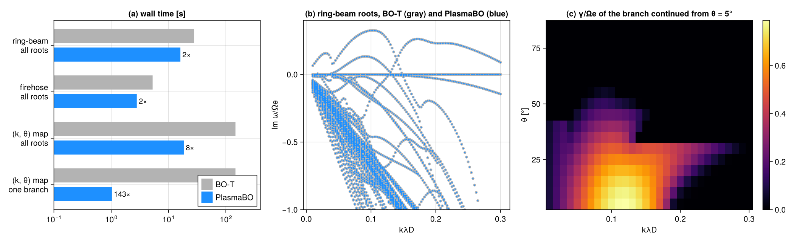

# PlasmaBO vs BO-T

[BO-T](https://github.com/FusionAlpha/botian) is the Python reference of Tian, Xie & Wei (2026);
`BOHH` uses the same reduction to the pole states the fields couple to. Here both solve the same
truncated relation from BO-T's own inputs at the same wavevectors.

> [!TIP]
> **Same roots, 2× faster per wavevector; 8× on a threaded (k, θ) map; ~140× when following the
> instability branch** instead of eigensolving every wavevector.



| task | PlasmaBO solver | BO-T | PlasmaBO | speedup | PlasmaBO root vs BO-T |
|---|---|---|---|---|---|
| ring-beam ([Umeda+ 2012](../../docs/src/ringbeam_Umeda12.md)), all roots, 117 k | `BOHH(8, 8)` | 27.9 s | 16.1 s | **1.7×** | ≤ 1e-06 |
| firehose ([Astfalk+ 2017](../../docs/src/firehose_Astfalk17.md)), all roots, 46 k | `BOHH(2, 24)` | 5.3 s | 2.8 s | **1.9×** | ≤ 7e-04 |
| ring-beam (k, θ) map, all roots, 510 k | `BOHH(8, 8)`, 10 threads | 147 s | 18.5 s | **8×** | |
| ring-beam (k, θ) map, unstable branch | `Continuation(BOHH(8, 8))` | 147 s | 1.03 s | **143×** | max γ/Ωe 0.788413 vs 0.788413 |

<sub>Apple M5, Julia 1.14, Python 3.12 + NumPy/SciPy on Accelerate, BO-T at `b9acc6d`.</sub>

## Reading the results

- **Roots.** Every PlasmaBO root in BO-T's plot window is also a BO-T root, to `|Δω|/(Ωe + |ω|)` in
  the last column. BO-T returns more roots: it also keeps pole states whose field coupling is below
  roundoff, while `BOHH` drops.
- **Speed.** Per wavevector both are bound by the same dense eigensolve, hence only ~2×. The gap
  comes from how a scan runs: BO-T solves wavevectors one after another;
  PlasmaBO threads sweeps, and `Continuation` follows one root by Newton steps without eigensolves.
- **Timing scope.** BO-T's timings cover its eigensolve only. Its root selector adds ~1.3 s per wavevector on the ring-beam case.

## Reproduce

```sh
git clone https://github.com/FusionAlpha/botian /tmp/botian && uv venv /tmp/botian/.venv
VIRTUAL_ENV=/tmp/botian/.venv uv pip install -r /tmp/botian/requirements.txt -e /tmp/botian
/tmp/botian/.venv/bin/python botian.py /tmp/botian      # BO-T roots + timings → results/, ~3 min
julia -t auto --project=../../docs compare.jl           # the table above and benchmark.png
```
